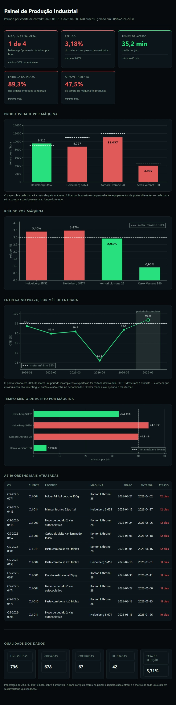

# Painel de Produção Industrial

Chão de fábrica gera dado o tempo todo, mas esse dado quase sempre mora em planilha — e planilha de produção é suja por natureza: o operador escreve o nome da máquina de três jeitos, a data vem em quatro formatos, alguém digita a mesma ordem duas vezes e no fim tem uma linha "TOTAL" que não é uma ordem de produção.

Este projeto é o pipeline que trata esse dado: lê as planilhas, limpa, valida, grava em banco, calcula os indicadores de produção e gera um painel — com um relatório explícito de tudo que foi corrigido ou rejeitado no caminho.



---

## Como rodar

```powershell
git clone <url-do-repositorio> && cd painel-producao
python -m venv .venv && .venv\Scripts\activate
pip install -r requirements.txt
python -m src.main tudo
```

O último comando faz tudo: gera as planilhas sintéticas, importa, calcula e produz as saídas. Depois é só abrir `saida/painel.html` com dois cliques — ele funciona offline.

Cada etapa também roda sozinha:

```powershell
python -m src.main gerar-dados --meses 6 --arquivos 3
python -m src.main importar --entrada dados/entrada
python -m src.main indicadores --de 2026-01-01 --ate 2026-06-30
python -m src.main painel
python -m src.main relatorio
```

Todos aceitam `--config caminho.yaml` e `--verbose`.

**Códigos de saída:** `0` sucesso · `1` erro de execução ou rejeição acima do limite · `2` erro de configuração. O código 1 na rejeição é deliberado: permite rodar em agendador e ser alertado sozinho quando a qualidade da entrada degradar.

---

## Aviso sobre os dados

> Os dados deste projeto são **sintéticos**, gerados pelo próprio repositório. Nenhum dado de empresa real foi utilizado, e clientes e operadores aparecem apenas como código (`CLI-001`, `OP-03`) — o mesmo tratamento que se daria a dado real ao compartilhá-lo fora da empresa. O gerador injeta inconsistências propositais para que o pipeline de tratamento seja exercitado de verdade.

São onze tipos de sujeira, todos vindos de planilha real: variantes do nome da máquina, quatro formatos de data (inclusive o serial do Excel), número como texto, célula obrigatória vazia, linha duplicada, valor impossível, cabeçalho fora da primeira linha, rodapé com somatório, espaço sobrando, variantes de status, e status incoerente com a data de entrega.

---

## O que sai de uma execução

| Saída | O que é |
|---|---|
| `saida/painel.html` | Arquivo único, autocontido, abre offline. Gráficos embutidos em base64 — sem CDN, sem pasta de imagens ao lado. |
| `saida/relatorio_producao.xlsx` | Cinco abas formatadas: Resumo, Por máquina, Por cliente, Atrasos e Qualidade dos dados. |
| `saida/relatorio_qualidade.csv` | Uma linha por ocorrência: arquivo, linha da planilha, coluna, valor original, problema, ação e valor final. |
| `logs/execucao.log` | `data hora \| nível \| módulo \| mensagem`. Nível configurável. |

Na execução de referência, sobre 6 meses de histórico em 3 planilhas:

```
736 linhas lidas  →  694 aprovadas  →  678 ordens no banco
 42 rejeitadas (5,71%)   67 linhas corrigidas   16 duplicatas colapsadas
```

Os 16 são a mesma ordem apontada duas vezes; a deduplicação acontece no banco e cada uma aparece no relatório de qualidade apontando a linha que ficou no lugar dela.

---

## Os indicadores

| Indicador | Fórmula | Leitura |
|---|---|---|
| **Produtividade** | `tiragem_boa / (tempo_producao_min / 60)` | folhas boas por hora de máquina |
| **Refugo** | `refugo / (tiragem_boa + refugo) × 100` | percentual de material perdido |
| **Tempo médio de setup** | `média(tempo_setup_min)` | minutos parados por job |
| **Cumprimento de prazo (OTD)** | `entregues até o prazo / total entregue × 100` | percentual de entrega no prazo |
| **Aproveitamento de tempo** | `tempo_producao / (tempo_producao + tempo_setup) × 100` | quanto do tempo total foi produção |

Cada um é calculado no total, por máquina, por turno e por mês. As metas ficam no `config.yaml` e o painel pinta verde ou vermelho comparando com elas.

**O agrupamento mensal é por coorte de entrada, não por data de entrega.** A ordem conta no mês em que entrou em produção. É o que mantém uma queda de OTD nítida no mês em que ela aconteceu, em vez de borrada entre dois meses — uma ordem que entra no fim de abril e atrasa é entregue em maio.

**Divisão por zero devolve `None`, e `None` vira "sem dado" na tela.** Ordem com `tempo_producao_min = 0` existe de verdade: é a que foi cancelada depois do acerto. O painel nunca mostra `inf` nem `NaN`, e o que não foi medido não fica nem verde nem vermelho — pintar de verde o que não foi medido é a forma mais fácil de um painel mentir.

---

## As quatro decisões de engenharia

### 1. Configuração externa, nada cravado no código

Nomes de coluna, sinônimos de máquina, limites de validação e metas ficam no `config.yaml`. Quando a fábrica renomear a coluna "TIRAGEM" para "QTD PREVISTA", ninguém precisa abrir código Python.

**Alternativa descartada:** dicionário Python dentro do módulo. Mais rápido de escrever, mas transforma toda mudança de processo em alteração de código.

**Tirar valor do código não basta — é preciso recusar a combinação de valores que não faz sentido.** Se toda máquina precisa ter entrada em `metas_produtividade`, `setup_por_maquina` e `refugo_por_maquina`, um nome digitado diferente numa das seções não alcança máquina nenhuma, e o efeito é silencioso: ela simplesmente sai do painel. O carregamento cruza as seções e recusa com código 2.

O critério: **se uma combinação de valores válidos produz silêncio em vez de erro, ela é recusada no carregamento.**

### 2. Falha visível, nunca silenciosa

Nenhuma linha some sem deixar rastro. Toda linha corrigida, rejeitada, descartada ou deduplicada vai para `saida/relatorio_qualidade.csv` com origem, linha, coluna, valor original, motivo e ação. Se a taxa de rejeição passar do limite do `config.yaml`, o programa sai com código 1.

**Alternativa descartada:** `df.dropna()` e seguir em frente. É uma linha de código, e é como se perde a confiança do usuário para sempre.

Dado que some sem aviso produz relatório bonito e errado, e um painel que mente é pior que painel nenhum. Por isso o rodapé do painel mostra a própria taxa de erro de ingestão: um painel que exibe quantas linhas ele perdeu no caminho é um painel em que dá para confiar.

As quatro ações são distintas de propósito. `duplicado` é benigno — duas linhas idênticas, colapso sem perda. `conflito` é problema de integridade — duas versões divergentes da mesma ordem, e o sistema escolheu uma sozinho. Juntar as duas faria o filtro do CSV misturar o caso comum que não exige nada com o caso raro que exige investigação.

### 3. Idempotência por hash da linha

Cada ordem carrega um `hash_linha`: SHA-256 da chave natural normalizada (número da OS + data de entrada + máquina). O `INSERT` usa `ON CONFLICT DO UPDATE`. Reprocessar a mesma pasta dez vezes produz exatamente o mesmo banco.

**Alternativa descartada:** apagar a tabela e reimportar tudo. Funciona, mas destrói o histórico de importações e não permite carga incremental.

Em automação de verdade o script vai rodar de novo — porque caiu no meio, porque chegou planilha corrigida, porque alguém clicou duas vezes. Se rodar de novo duplica dado, o sistema é uma armadilha.

**"Exatamente o mesmo banco" é literal, e custa uma cláusula.** O upsert só reescreve a linha quando algum campo de conteúdo mudou de verdade; sem essa guarda, o carimbo `importado_em` seria reescrito a cada execução e o banco mudaria sozinho a cada rodada — com a contagem de linhas parada, o que faria a idempotência parecer intacta. A única coisa que cresce numa reimportação é a tabela `execucao_importacao`, que é o histórico.

### 4. Camadas separadas

`leitura` → `limpeza` → `validacao` → `banco` → `indicadores` → `apresentacao`. Cada módulo tem uma responsabilidade e recebe o que precisa como parâmetro.

**Alternativa descartada:** um script único que lê, trata e desenha. Funciona até a primeira mudança, e depois toda alteração exige entender o arquivo inteiro.

Dá para testar a limpeza sem ter planilha e calcular indicador sem ter banco. Módulo que só faz uma coisa é módulo que dá para consertar sem medo — e é o que permite os 338 testes rodarem em menos de um minuto.

---

## O que o sistema não faz

Saber dizer o que o sistema **não** faz é parte do projeto.

- **Não é sistema de apontamento em tempo real.** É análise em lote.
- **Não tem interface web interativa nem banco de servidor.** SQLite e HTML estático.
- **Não integra com ERP.** A entrada é planilha, porque é assim que a maioria das fábricas realmente exporta.

---

## Limitações conhecidas

### Uma linha = uma ordem é simplificação consciente

Na prática o apontamento é **por etapa**: a ordem percorre um roteiro (impressão, dobra, corte) e cada etapa gera seu próprio apontamento. O modelo correto seria cabeçalho e detalhe. Este projeto registra apenas a etapa de impressão.

O que a simplificação custa: **não mede gargalo de acabamento.** Guilhotina e dobradeira não entram na lista de máquinas porque não produzem a ordem. Em compensação, os indicadores por máquina de impressão continuam válidos.

A tiragem é sempre em **folhas impressas, nunca em peças acabadas** — mil folhas SRA3 de cartão de visita são cerca de 21.000 peças, e quem lê o painel precisa saber qual das duas está vendo.

### O último mês sofre censura à direita

A ordem cuja entrega cairia depois da data de corte da exportação aparece como `EM PRODUCAO`, sem data de entrega. **Isso não é neutro:** atraso empurra a entrega para frente, então o corte remove seletivamente as ordens ruins, e o último mês fica com um OTD artificialmente alto.

É propriedade de qualquer exportação real, não defeito do gerador. O tratamento é **marcar, nunca esconder**: no gráfico de OTD o mês sai com ponto vazado, traço pontilhado e faixa sombreada, mais nota de rodapé explicando que o valor é otimista. Remover o mês maquiaria o resultado; deixá-lo sem marca seria mentir por omissão.

### Célula ilegível rejeita a ordem inteira

Quando um valor não pode ser convertido — nome de máquina que não casa com nenhum sinônimo, turno digitado `4`, data `31/02/2026` — a linha inteira vai para as rejeitadas.

**Alternativa descartada:** gravar a ordem com a célula em branco e tratar o desconhecido como membro explícito da dimensão, `(não informado)`. É o padrão em BI, e a vantagem é real: o total permanece coerente com os cortes e o desconhecido aparece na tela como a categoria que é.

Não foi adotada por custo sobre uso — nenhuma das 42 rejeições do histórico atual vem de valor ilegível, e a alternativa acrescentaria um membro em cada dimensão e uma decisão de exibição em cada gráfico. **O custo da escolha é real:** uma planilha que passe a trazer um turno não declarado no `config.yaml` perde as ordens inteiras. O sintoma aparece na taxa de rejeição, não em silêncio, e a resposta certa é declarar o turno — não afrouxar a regra.

### O indicador "máquinas na meta" é circular no dado sintético

`metas_produtividade` é ao mesmo tempo o alvo que o painel compara e o centro em torno do qual o gerador sorteia a velocidade de cada máquina. Com `uniform(0.80, 1.20)` da própria meta, metade fica abaixo **por construção**: o indicador orbita 50% porque o dado nasceu assim, não porque a fábrica está assim.

Em dado real ele teria valor de diagnóstico. Aqui demonstra o mecanismo do painel, não o estado de um parque — e é a diferença entre um número que informa e um número que apenas funciona.

**A resolução também é grosseira com quatro máquinas:** o percentual só assume 0, 25, 50, 75 ou 100, e um único equipamento move 25 pontos. O indicador melhora sozinho conforme o parque cresce.

### Outras fronteiras

- **Volume.** Dimensionado para milhares de linhas. Se virar milhões, a arquitetura de "carrega tudo em memória" quebra e a resposta certa passa a ser processamento em pedaços ou banco de servidor.
- **Detecção do cabeçalho.** A heurística conta quantas células da linha são apelido conhecido. Funciona bem, mas planilha com duas tabelas na mesma aba quebra.
- **Serial do Excel.** A conversão depende do sistema de datas da planilha. Assumido 1900, padrão no Windows; uma planilha salva no sistema de 1904 sairia com quatro anos de erro.
- **Data ambígua.** `05/03/2026` é lido como 5 de março, nunca 3 de maio. Não há como distinguir numa célula isolada, e dd/mm é o formato do teclado brasileiro — mas uma planilha exportada em locale americano seria lida errada sem erro nenhum. É a limitação mais perigosa do módulo de limpeza.
- **Produtividade em folhas/hora** é simplificação: produtividade real de gráfica considera formato, número de cores e gramatura. O indicador é honesto para comparar a mesma máquina ao longo do tempo, e frágil entre máquinas de portes diferentes. Por isso a meta é por máquina, e o cartão global mostra "X de N máquinas na meta" em vez de uma média.

---

## Estrutura

```
painel-producao/
├─ config.yaml              <- toda a configuração do pipeline
├─ dados/
│  ├─ entrada/              <- planilhas .xlsx (ignoradas pelo git)
│  └─ producao.db           <- SQLite (ignorado pelo git)
├─ saida/                   <- painel, relatório e CSV de qualidade (ignorada)
├─ logs/                    <- ignorada pelo git
├─ docs/
│  └─ painel_exemplo.png    <- print do painel, este VAI para o git
├─ src/
│  ├─ config.py             <- carrega e valida o YAML, com cruzamento entre seções
│  ├─ gerador_dados.py      <- planilhas sintéticas com sujeira controlada
│  ├─ leitura.py            <- acha o cabeçalho real, descarta rodapé
│  ├─ limpeza.py            <- datas, números, nomes de máquina, turnos, status
│  ├─ validacao.py          <- regras de negócio e relatório de qualidade
│  ├─ banco.py              <- esquema, hash da chave natural, upsert idempotente
│  ├─ indicadores.py        <- os cinco indicadores, com as somas à vista
│  ├─ painel.py             <- HTML autocontido com gráficos em base64
│  ├─ relatorio_excel.py    <- as cinco abas formatadas
│  └─ main.py               <- subcomandos, logging e códigos de saída
└─ tests/                   <- 338 testes
```

**Rodar os testes:**

```powershell
pytest
```

Os testes cobrem as funções críticas de cada camada: os formatos de data e número da limpeza, cada regra de validação com um caso que viola e um que passa raspando pelo limite, as cinco fórmulas dos indicadores com denominador zerado, a idempotência do banco no sentido forte (as linhas ficam idênticas, não só a contagem), e o contrato da linha de comando.

---

## Sobre uso de IA

O código deste projeto foi gerado com Claude Code a partir de uma especificação técnica escrita antes da primeira linha de código. Ela está neste repositório e define o modelo de dados, as regras de negócio, as quatro decisões de arquitetura e o critério de aceite de cada um dos dez blocos.

A construção foi bloco a bloco, e nenhum começou antes de eu revisar, testar e aprovar o anterior. As decisões de projeto são minhas e estão registradas na especificação e no histórico de commits — entre elas: manter o modelo plano em vez de cabeçalho-detalhe e documentar o que essa simplificação custa; separar "conflito" de "duplicata" no relatório de qualidade, porque um exige investigação e o outro não; definir a meta de cada indicador; e amarrar máquina e tiragem ao produto, correção que veio de quase cinco anos de indústria gráfica e não de requisito escrito.

As saídas foram conferidas fora do programa: abri as planilhas geradas, e reconferi os indicadores de uma máquina com calculadora contra os dados brutos.

O que ainda não fiz: reescrever o código à mão, módulo por módulo, até conseguir explicar cada parte sem consultar nada. É o próximo passo, e até ele terminar este repositório permanece privado.

---

*Sapere aude.*
